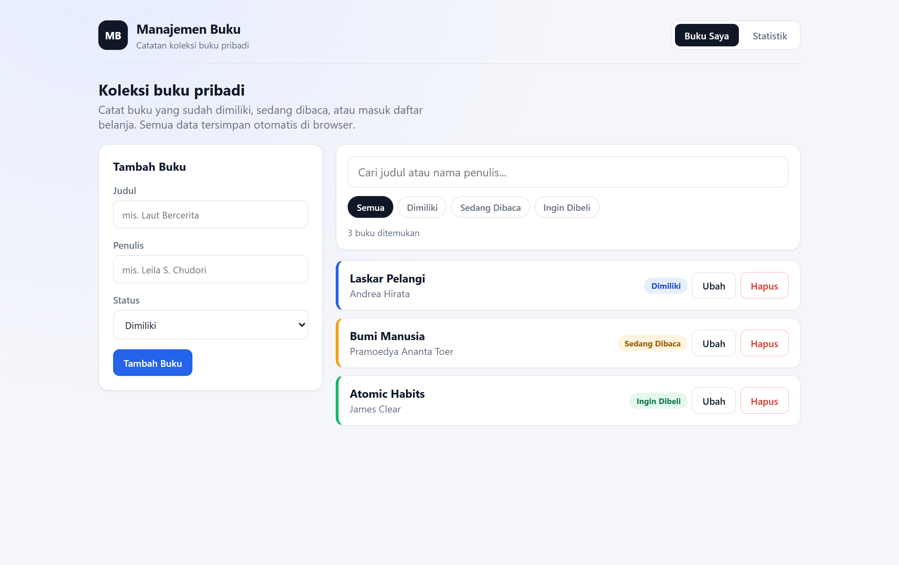
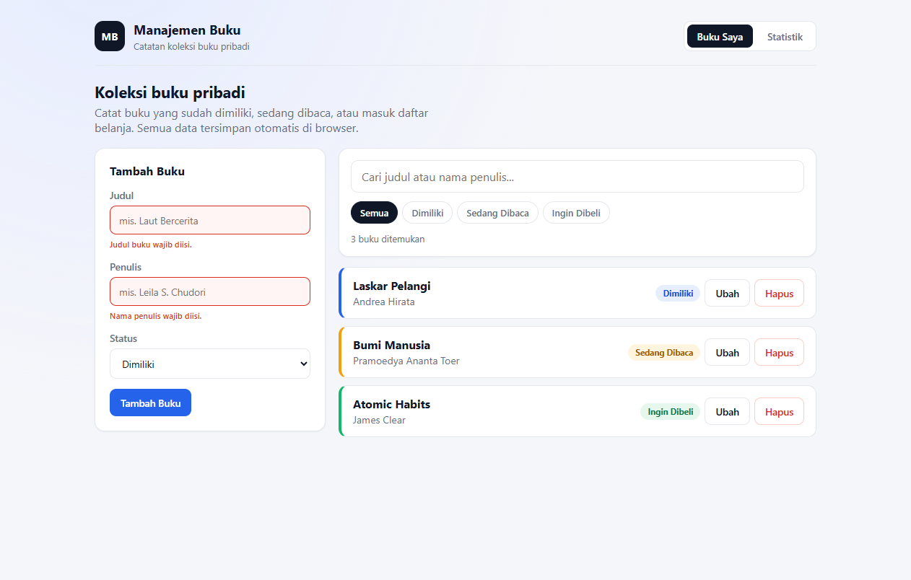
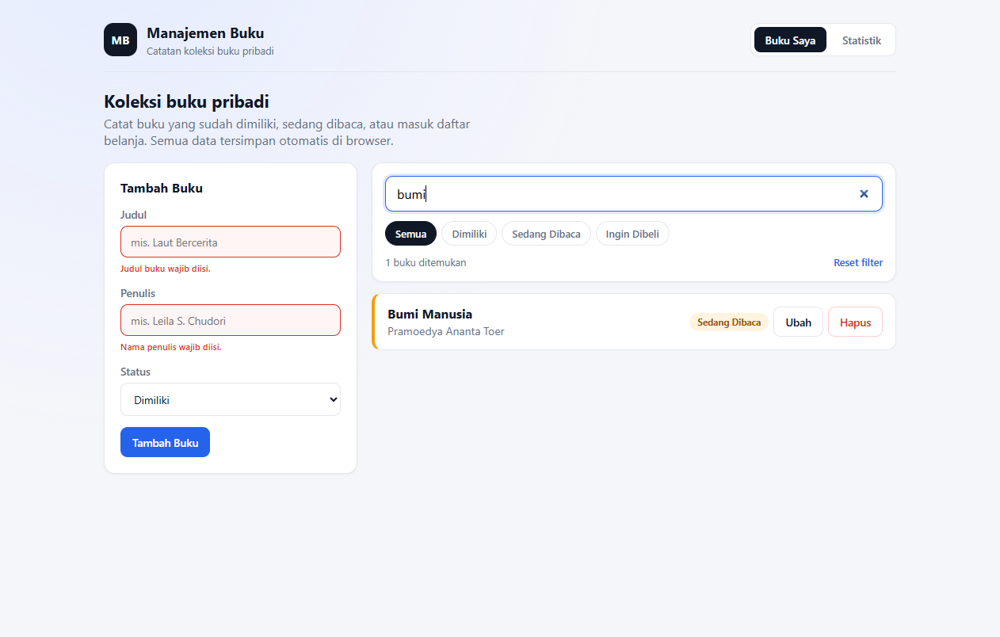
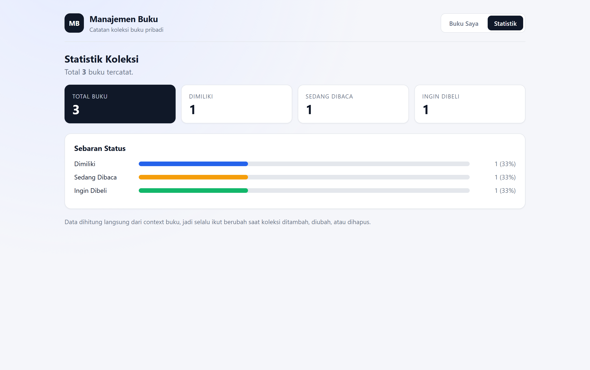
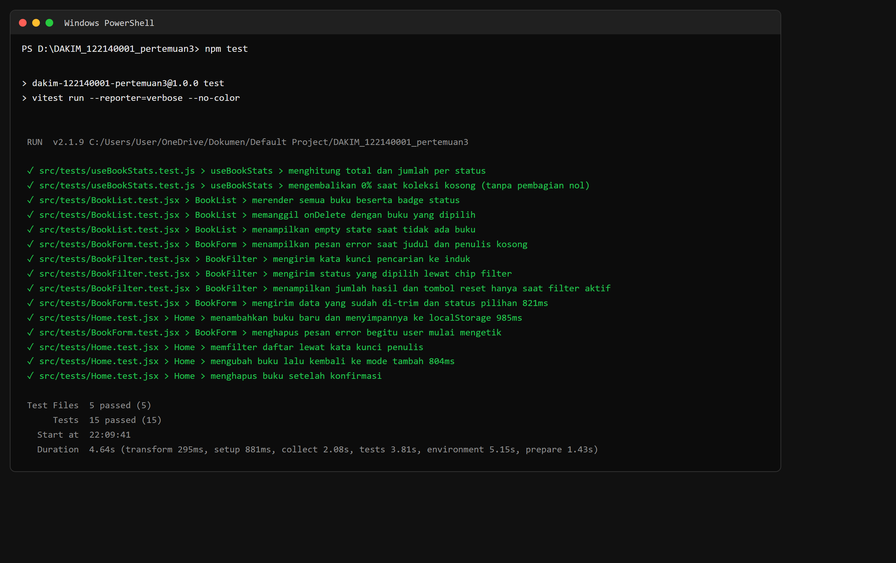

# Aplikasi Manajemen Buku Pribadi

Tugas Pertemuan 3 — project React terpisah untuk mencatat koleksi buku pribadi: buku yang sudah **dimiliki**, sedang **dibaca**, atau masuk daftar **ingin dibeli**.

Data disimpan di `localStorage`, jadi koleksi tetap ada setelah browser ditutup. Aplikasi terdiri dari dua halaman (daftar buku dan statistik) dengan navigasi React Router.

- **Nama:** Cania Febriyanti
- **NIM:** 124140153
- **Folder:** `CANIA_124140153_pertemuan3`

---

## Fitur

| Fitur | Keterangan |
| --- | --- |
| Tambah buku | Judul, penulis, dan status (Dimiliki / Sedang Dibaca / Ingin Dibeli) |
| Edit buku | Tombol **Ubah** mengisi form, simpan perubahan mengganti data lama |
| Hapus buku | Tombol **Hapus** dengan konfirmasi sebelum data dibuang |
| Filter status | Chip **Semua / Dimiliki / Sedang Dibaca / Ingin Dibeli** |
| Pencarian | Berdasarkan judul **atau** nama penulis, bisa digabung dengan filter |
| Validasi form | Kolom wajib divalidasi, input kosong diberi border merah + pesan error |
| Statistik | Total buku dan sebaran status dalam bentuk kartu dan bar persentase |
| Persistensi | Semua perubahan otomatis tersimpan di `localStorage` |

---

## Screenshot Antarmuka

### 1. Halaman utama — daftar buku, form tambah, filter, dan pencarian



### 2. Error handling form — submit dengan kolom kosong

Border input berubah merah, pesan error muncul di bawah kolom, dan `aria-invalid` diset untuk pembaca layar. Pesan otomatis hilang begitu pengguna mulai mengetik.



### 3. Pencarian judul / penulis

Kata kunci `bumi` menyaring daftar menjadi satu buku dan menampilkan jumlah hasil.



### 4. Halaman statistik



---

## Instalasi dan Cara Menjalankan

Prasyarat: Node.js 18+ dan npm.

```bash
# 1. Masuk ke folder project
cd DAKIM_122140001_pertemuan3

# 2. Pasang dependency
npm install

# 3. Jalankan mode development (http://localhost:5173)
npm run dev

# 4. Jalankan unit test
npm test

# 5. Build produksi
npm run build
```

Dependency utama: `react`, `react-dom`, `react-router-dom`, `prop-types`.
Dependency testing: `vitest`, `@testing-library/react`, `@testing-library/jest-dom`, `@testing-library/user-event`, `jsdom`.

---

## Struktur Folder

```
src/
├─ components/
│  ├─ BookForm/      → BookForm.jsx + BookForm.css
│  ├─ BookList/      → BookList.jsx + BookList.css
│  └─ BookFilter/    → BookFilter.jsx + BookFilter.css
├─ pages/
│  ├─ Home/          → Home.jsx + Home.css
│  └─ Stats/         → Stats.jsx + Stats.css
├─ hooks/
│  ├─ useLocalStorage.js
│  └─ useBookStats.js
├─ context/
│  └─ BookContext.jsx
├─ tests/
│  ├─ setup.js
│  ├─ BookForm.test.jsx
│  ├─ BookFilter.test.jsx
│  ├─ BookList.test.jsx
│  ├─ Home.test.jsx
│  └─ useBookStats.test.js
├─ App.jsx
├─ main.jsx
└─ index.css
```

---

## Penjelasan Fitur React yang Digunakan

### 1. `useState`

Dipakai untuk semua state yang berubah karena interaksi pengguna:

- `BookForm` → isi form (`title`, `author`, `status`) dan objek `errors`.
- `Home` → kata kunci pencarian, filter status, dan buku yang sedang diedit.
- `useLocalStorage` → nilai state yang dicerminkan ke `localStorage`.

### 2. `useEffect`

- `useLocalStorage` — menulis ke `localStorage` setiap nilai berubah (sinkronisasi state → storage).
- `BookForm` — mengisi ulang form saat `initialBook` berubah (mode tambah ↔ ubah).
- `Home` dan `Stats` — memperbarui `document.title` sesuai halaman/jumlah buku.

### 3. `useMemo`

- `Home` — hasil filter + pencarian hanya dihitung ulang saat `books`, `status`, atau `query` berubah.
- `useBookStats` — agregasi statistik dihitung sekali per perubahan daftar buku.

### 4. Context API

`src/context/BookContext.jsx` menyimpan satu sumber data buku dan operasi `addBook`, `updateBook`, `deleteBook`. Halaman `Home` dan `Stats` memakai hook `useBooks()` tanpa prop drilling, sehingga statistik selalu sinkron dengan daftar.

### 5. React Router

`BrowserRouter` + `Routes` di `App.jsx`:

- `/` → halaman **Buku Saya** (`Home`)
- `/statistik` → halaman **Statistik** (`Stats`)
- `*` → fallback halaman tidak ditemukan

`NavLink` memberi class `active` otomatis pada menu yang sedang dibuka.

### 6. Custom Hooks

| Hook | Tugas |
| --- | --- |
| `useLocalStorage(key, initialValue)` | State persisten: baca nilai awal dari `localStorage`, tulis ulang setiap berubah, aman terhadap JSON rusak dan kuota penuh |
| `useBookStats(books)` | Ringkasan koleksi: total, jumlah per status, dan helper `percentOf()` untuk bar persentase |

### 7. PropTypes

Semua komponen menerima PropTypes: `BookForm` (`initialBook`, `onSubmit`, `onCancel`), `BookList` (`books`, `onEdit`, `onDelete`), `BookFilter` (`query`, `status`, `onQueryChange`, `onStatusChange`, `onReset`, `resultCount`), `BookProvider` (`children`), serta shape buku dengan `status` dibatasi `oneOf`.

### 8. Functional Components + Hooks

Tidak ada class component. Semua komponen berupa function yang memakai Hooks, dengan komponen reusable: `BookForm`, `BookList` (+ `BookItem`), dan `BookFilter`.

---

## Error Handling

1. **Validasi input** — `validate()` di `BookForm` menolak judul/penulis kosong atau berisi spasi saja (`trim()`).
2. **Feedback visual** — input tidak valid diberi class `input-error` (border merah + latar merah muda), pesan `error-text`, dan `aria-invalid`.
3. **Error hilang saat diperbaiki** — pesan per kolom dihapus begitu pengguna mengetik di kolom tersebut.
4. **Data rusak** — `useLocalStorage` membungkus `JSON.parse` dengan `try/catch`; bila isi storage tidak valid, aplikasi kembali ke data awal alih-alih crash.
5. **Storage tidak tersedia** — kegagalan `setItem` (kuota penuh/mode privat) ditangkap agar aplikasi tetap berjalan.
6. **Konfirmasi hapus** — penghapusan buku meminta konfirmasi lebih dulu.

---

## Laporan Testing

15 unit test di 5 file, dijalankan dengan Vitest + React Testing Library (`npm test`).



| File | Test | Yang diverifikasi |
| --- | --- | --- |
| `BookForm.test.jsx` | menampilkan pesan error saat judul dan penulis kosong | Validasi + `aria-invalid`, `onSubmit` tidak dipanggil |
| `BookForm.test.jsx` | mengirim data yang sudah di-trim dan status pilihan | `trim()` dan nilai status dari select |
| `BookForm.test.jsx` | menghapus pesan error begitu user mulai mengetik | Feedback error reaktif |
| `BookFilter.test.jsx` | mengirim kata kunci pencarian ke induk | Input pencarian controlled |
| `BookFilter.test.jsx` | mengirim status yang dipilih lewat chip filter | Callback filter status |
| `BookFilter.test.jsx` | menampilkan jumlah hasil dan tombol reset hanya saat filter aktif | Conditional rendering + reset |
| `BookList.test.jsx` | merender semua buku beserta badge status | Jumlah item dan label status |
| `BookList.test.jsx` | memanggil onDelete dengan buku yang dipilih | Callback hapus |
| `BookList.test.jsx` | menampilkan empty state saat tidak ada buku | Empty state |
| `useBookStats.test.js` | menghitung total dan jumlah per status | Agregasi statistik |
| `useBookStats.test.js` | mengembalikan 0% saat koleksi kosong | Anti pembagian nol |
| `Home.test.jsx` | menambahkan buku baru dan menyimpannya ke localStorage | Integrasi Context + `useLocalStorage` |
| `Home.test.jsx` | memfilter daftar lewat kata kunci penulis | Integrasi pencarian |
| `Home.test.jsx` | mengubah buku lalu kembali ke mode tambah | Alur edit |
| `Home.test.jsx` | menghapus buku setelah konfirmasi | Alur hapus + konfirmasi |

Hasil terakhir:

```
Test Files  5 passed (5)
     Tests  15 passed (15)
  Duration  4.64s
```
