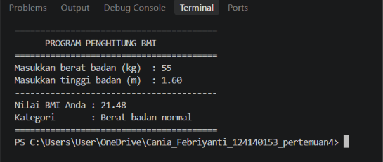
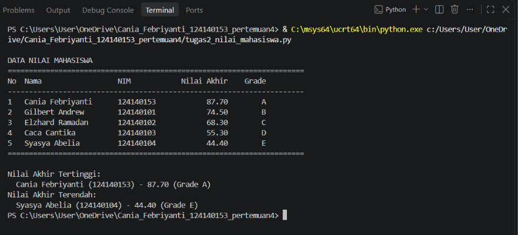
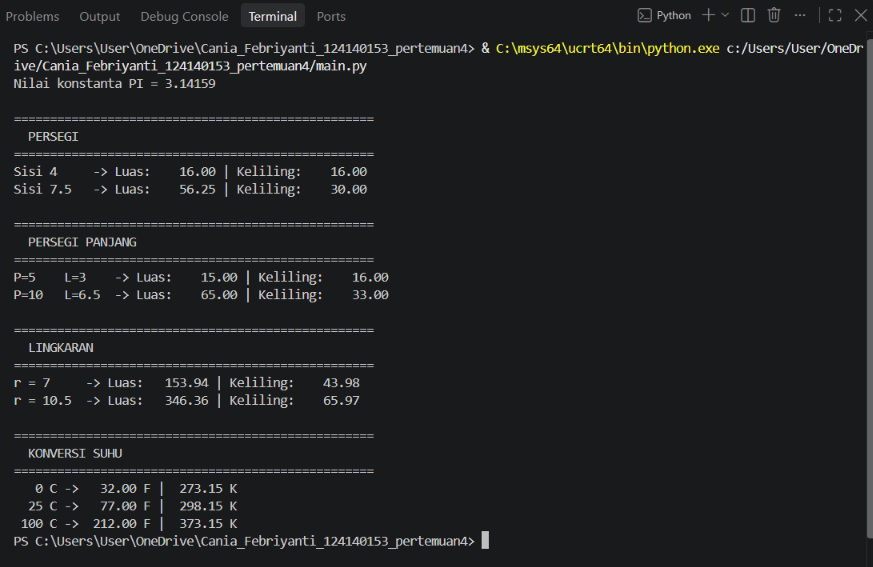

# Tugas Praktikum Pertemuan 4 - Python Dasar

## Identitas Mahasiswa
| Keterangan | Data |
|------------|------|
| Nama | Cania Febriyanti |
| NIM | 124140153 |
| Kelas | RB |

## Struktur Folder
```
Cania_Febriyanti_124140153_pertemuan4/
├── screenshots/
│   ├── soal1.png
│   ├── soal2.png
│   └── soal3.png
├── .gitignore
├── main.py
├── math_operations.py
├── README.md
├── tugas1_bmi.py
└── tugas2_nilai_mahasiswa.py
```

## Deskripsi Program

### Soal 1 - Program Penghitung BMI (`tugas1_bmi.py`)

**Alur kerja:**
1. Program meminta input berat badan (kg) dan tinggi badan (m) melalui `input()`.
2. Input divalidasi: harus berupa angka dan lebih besar dari 0.
3. Nilai BMI dihitung dengan rumus `berat / (tinggi * tinggi)`.
4. Kategori BMI ditentukan dengan struktur `if-elif-else`:
   - BMI < 18.5 : Berat badan kurang
   - 18.5 <= BMI < 25 : Berat badan normal
   - 25 <= BMI < 30 : Berat badan berlebih
   - BMI >= 30 : Obesitas
5. Nilai BMI (2 angka desimal dengan f-string) dan kategorinya dicetak ke terminal.

**Fungsi:**
| Fungsi | Kegunaan |
|--------|----------|
| `hitung_bmi(berat, tinggi)` | Menghitung dan mengembalikan nilai BMI |
| `tentukan_kategori(bmi)` | Mengembalikan kategori berat badan berdasarkan BMI |
| `main()` | Menjalankan alur program (input, hitung, cetak hasil) |

### Soal 2 - Pengelolaan Data Nilai Mahasiswa (`tugas2_nilai_mahasiswa.py`)

**Alur kerja:**
1. Data 5 mahasiswa disimpan dalam list berisi dictionary dengan kunci `nama`,
   `nim`, `nilai_uts`, `nilai_uas`, dan `nilai_tugas`.
2. Untuk setiap mahasiswa, nilai akhir dihitung dengan rumus
   `(30% * UTS) + (40% * UAS) + (30% * Tugas)`.
3. Grade ditentukan dari nilai akhir: A (>= 80), B (70-79), C (60-69),
   D (50-59), E (< 50).
4. Seluruh data (Nama, NIM, Nilai Akhir, Grade) ditampilkan dalam format tabel
   menggunakan f-string.
5. Program mencari dan menampilkan mahasiswa dengan nilai akhir tertinggi dan
   terendah.

**Fungsi:**
| Fungsi | Kegunaan |
|--------|----------|
| `hitung_nilai_akhir(uts, uas, tugas)` | Menghitung nilai akhir berdasarkan bobot |
| `tentukan_grade(nilai_akhir)` | Mengembalikan grade A-E |
| `proses_data(daftar)` | Menambahkan nilai akhir dan grade ke setiap mahasiswa |
| `tampilkan_tabel(daftar)` | Mencetak data mahasiswa dalam format tabel |
| `cari_nilai_ekstrem(daftar)` | Mengembalikan mahasiswa dengan nilai tertinggi dan terendah |
| `main()` | Menjalankan alur program |

### Soal 3 - Modul Matematika (`math_operations.py` & `main.py`)

**Alur kerja:**
1. `math_operations.py` adalah modul berisi fungsi-fungsi perhitungan dan
   konstanta `PI = 3.14159`. Modul ini tidak dijalankan langsung.
2. `main.py` mengimpor modul tersebut dengan dua cara berbeda:
   - `import math_operations` (dipanggil dengan awalan nama modul)
   - `from math_operations import ...` (fungsi dipanggil langsung)
3. `main.py` memanggil seluruh fungsi modul dengan berbagai nilai uji, lalu
   mencetak hasilnya ke terminal dalam format yang rapi.

**Fungsi pada `math_operations.py`:**
| Fungsi | Kegunaan |
|--------|----------|
| `luas_persegi(sisi)` | Menghitung luas persegi |
| `keliling_persegi(sisi)` | Menghitung keliling persegi |
| `luas_persegi_panjang(panjang, lebar)` | Menghitung luas persegi panjang |
| `keliling_persegi_panjang(panjang, lebar)` | Menghitung keliling persegi panjang |
| `luas_lingkaran(jari_jari)` | Menghitung luas lingkaran |
| `keliling_lingkaran(jari_jari)` | Menghitung keliling lingkaran |
| `celsius_ke_fahrenheit(celsius)` | Konversi suhu Celsius ke Fahrenheit |
| `celsius_ke_kelvin(celsius)` | Konversi suhu Celsius ke Kelvin |

**Fungsi pada `main.py`:**
| Fungsi | Kegunaan |
|--------|----------|
| `tampilkan_judul(judul)` | Mencetak judul bagian dengan garis pembatas |
| `main()` | Menguji seluruh fungsi pada `math_operations` |

## Cara Menjalankan
Pastikan Python 3 sudah terpasang (cek dengan `python --version`), lalu buka
terminal pada folder proyek dan jalankan perintah berikut:

```bash
# Soal 1 - Program BMI (akan meminta input berat dan tinggi badan)
python tugas1_bmi.py

# Soal 2 - Pengelolaan nilai mahasiswa
python tugas2_nilai_mahasiswa.py

# Soal 3 - Program utama yang memanggil modul math_operations
python main.py
```

> Catatan: `math_operations.py` adalah modul, sehingga tidak dijalankan
> langsung. Modul ini dipanggil melalui `main.py`.

## Screenshot Hasil Eksekusi

### Soal 1 - Program Penghitung BMI


### Soal 2 - Pengelolaan Data Nilai Mahasiswa


### Soal 3 - Modul Matematika


## Catatan Penulisan Kode
- Setiap fungsi dilengkapi **docstring** yang menjelaskan parameter input dan
  nilai kembaliannya.
- Kode mengikuti konvensi **PEP 8**: indentasi 4 spasi yang konsisten dan
  penamaan variabel serta fungsi menggunakan `snake_case`.