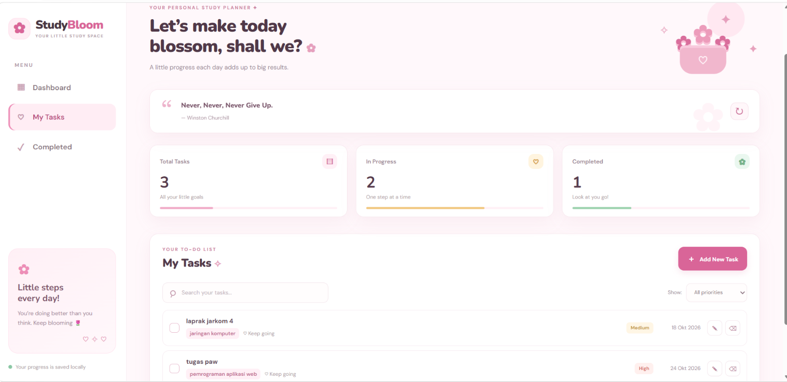

# 🌷 StudyBloom — Student Productivity Dashboard

StudyBloom adalah aplikasi dashboard produktivitas sederhana untuk membantu mahasiswa mengatur tugas kuliah dan memantau progres belajar dalam satu halaman. Aplikasi ini dibuat menggunakan HTML, CSS, dan JavaScript dengan tampilan yang sederhana dan responsif.

## Fitur Aplikasi

- **Tambah tugas:** menambahkan tugas kuliah baru.
- **Edit tugas:** mengubah informasi tugas yang sudah dibuat.
- **Hapus tugas:** menghapus tugas dari daftar.
- **Tandai selesai:** menandai tugas yang sudah dikerjakan.
- **Penyimpanan otomatis:** data tugas disimpan di `localStorage`, sehingga tetap tersedia saat halaman dibuka kembali di browser yang sama.
- **Pencarian tugas:** mencari tugas berdasarkan kata kunci.
- **Filter tugas:** menampilkan tugas sesuai statusnya.
- **Statistik tugas:** melihat ringkasan tugas dan progres penyelesaian.
- **Kutipan motivasi:** mengambil kutipan melalui API menggunakan `fetch` dan `async/await`.
- **Desain responsif:** tampilan menyesuaikan ukuran layar.

## Screenshot Aplikasi

Berikut adalah tampilan dashboard utama StudyBloom.



## Fitur ES6+ yang Digunakan

Berikut beberapa fitur JavaScript ES6+ yang digunakan dalam proyek.

| Fitur | Kegunaan | Referensi baris `script.js` |
|---|---|---|
| `let` dan `const` | Mendeklarasikan variabel dan nilai konstan. | Sekitar baris 5–6 dan 238 |
| Arrow function | Membuat fungsi dengan sintaks ringkas, termasuk callback event. | Sekitar baris 46, 58–75, 102, 130–132, 145–149, 156, 166–173, 183, 198, dan 260 |
| Template literals | Menyusun string HTML dengan interpolasi variabel. | Sekitar baris 207–220 |
| Destructuring | Mengambil nilai dari objek atau hasil pemrosesan data. | Sekitar baris 9, 81, 105, 126, 166, 183, 204, dan 239 |
| Spread syntax (`...`) | Menyalin atau menggabungkan data array/objek. | Sekitar baris 131, 136, dan 156 |
| Array methods | Mengolah daftar tugas menggunakan metode seperti `map`, `filter`, dan `find`. | Sekitar baris 46, 102, 130, 145, 149, 156, 166–173, 183, dan 198 |
| Classes | Mengelompokkan data dan perilaku aplikasi melalui class `TaskItem` dan `DashboardApp`. | Sekitar baris 8–20 |
| `async/await` | Menangani proses asynchronous saat mengambil kutipan motivasi. | Sekitar baris 229–249 |
| `fetch()` | Mengambil data kutipan dari API. | Sekitar baris 236–237 |
| `localStorage` | Menyimpan dan membaca daftar tugas di browser. | Sekitar baris 45 dan 54 |
| `Object.fromEntries()` | Mengubah pasangan data menjadi objek. | Sekitar baris 126 |

## Penyimpanan Data

Daftar tugas disimpan di browser menggunakan `localStorage` dengan key berikut:

```text
studyBloomTasks
```

Data disimpan secara lokal di browser yang digunakan. Karena itu, data tidak otomatis tersinkronisasi ke perangkat atau browser lain.

## Teknologi yang Digunakan

- **HTML** untuk struktur halaman.
- **CSS** untuk desain, tata letak, dan tampilan responsif.
- **JavaScript (ES6+)** untuk interaksi, pengelolaan tugas, dan pengolahan data.
- **localStorage** untuk menyimpan tugas di browser.
- **Fetch API** untuk mengambil kutipan motivasi.
