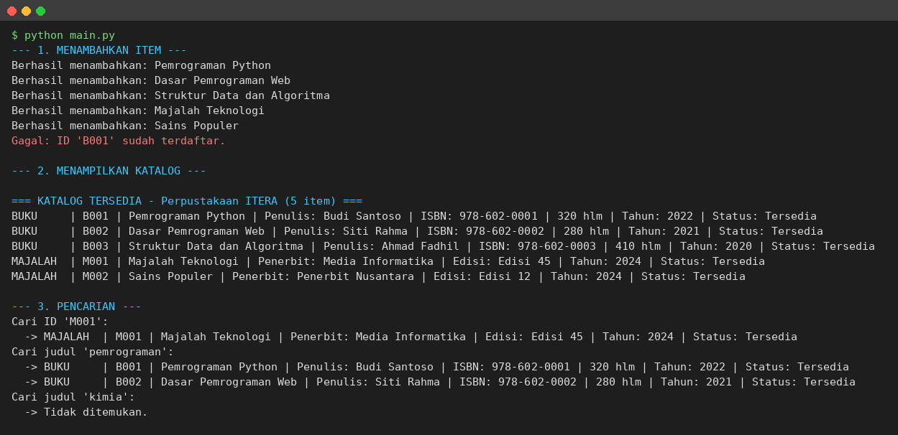
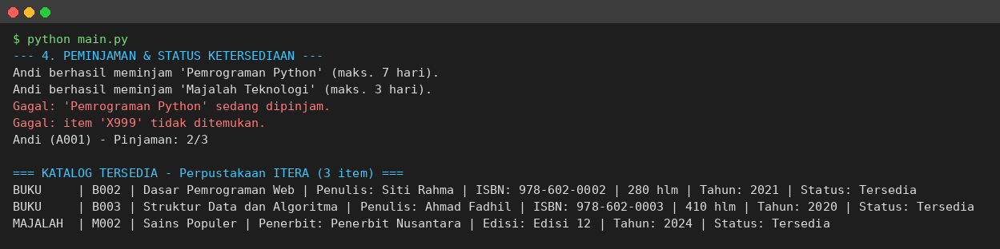
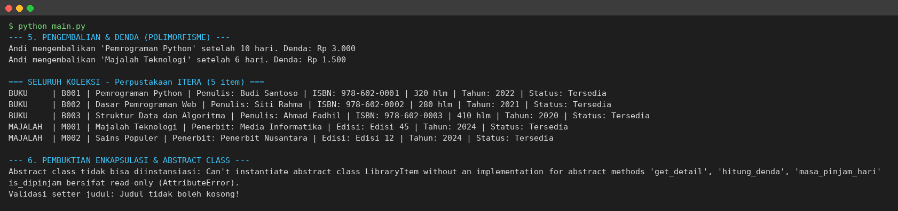

# Tugas Praktikum Pertemuan 5 - Sistem Manajemen Perpustakaan (Python OOP)

## Identitas Mahasiswa

| Nama Lengkap | Cania Febriyanti |
| NIM | 124140153 |
| Kelas Praktikum | RB |

## Deskripsi Program

Program ini adalah sistem manajemen perpustakaan sederhana berbasis OOP Python. Perpustakaan dapat menyimpan dua jenis item, yaitu **buku** dan **majalah**. Anggota dapat meminjam dan mengembalikan item, dan sistem menghitung denda keterlambatan.

### Alur Program (`main.py`)

1. Membuat objek `Library`, lalu **menambahkan** 3 buku dan 2 majalah (penambahan dengan ID kembar ditolak).
2. **Menampilkan katalog** item yang tersedia.
3. **Mencari** item berdasarkan ID dan berdasarkan judul (kata kunci, tidak case-sensitive).
4. **Meminjam** item lewat objek `Member`, lalu menampilkan perubahan status ketersediaan di katalog.
5. **Mengembalikan** item dan menghitung denda sesuai jenis item.
6. Membuktikan proteksi enkapsulasi dan abstract class.

### Struktur Berkas

| Berkas | Isi |
| --- | --- |
| `library_item.py` | Abstract class `LibraryItem`, subclass `Book` dan `Magazine` |
| `member.py` | Class `Member` (anggota perpustakaan) |
| `library.py` | Class `Library` untuk mengelola koleksi |
| `main.py` | Skrip uji coba seluruh fitur |

### Penerapan 4 Pilar OOP

**1. Class & Abstract Class**
`LibraryItem(ABC)` adalah kelas dasar yang tidak bisa diinstansiasi langsung. Kelas ini memiliki tiga abstract member: `get_detail()`, `hitung_denda()`, dan property `masa_pinjam_hari`. Class lain (`Library`, `Member`) memodelkan entitas nyata dan saling berkolaborasi.

**2. Inheritance**
`Book` dan `Magazine` mewarisi `LibraryItem`. Keduanya memakai kembali atribut dan method umum (`pinjam()`, `kembalikan()`, `__str__`) lewat `super().__init__()`, lalu menambahkan atribut khusus (`penulis`, `isbn` untuk buku; `penerbit`, `edisi` untuk majalah).

**3. Encapsulation**
- Private: `__dipinjam` (di `LibraryItem`), `__koleksi` (di `Library`), dan `__item_dipinjam` (di `Member`).
- Protected: `_item_id`, `_judul`, `_tahun_terbit`, `_isbn`, `_member_id`.
- Property: `is_dipinjam` (read-only), `judul` (getter + setter dengan validasi tidak boleh kosong), `item_id`, `jumlah_pinjaman`, dan `daftar_pinjaman` (mengembalikan salinan list).

**4. Polymorphism**
`Library` memanggil `item.get_detail()` dan `item.hitung_denda()` tanpa mengecek tipe item. Setiap subclass menjawab dengan caranya sendiri:

| Jenis | Masa Pinjam | Denda per Hari |
| --- | --- | --- |
| Book | 7 hari | Rp 1.000 |
| Magazine | 3 hari | Rp 500 |

## Panduan Menjalankan Program

Prasyarat: Python 3.10 atau lebih baru.

```bash
cd tugas_perpustakaan
python main.py
```

(Gunakan `python3 main.py` jika `python` tidak dikenali.)

## Screenshot Output

### 1. Penambahan item, katalog, dan pencarian


### 2. Peminjaman dan perubahan status ketersediaan


### 3. Pengembalian, denda, dan pembuktian enkapsulasi


## Struktur Repositori

```
caniafebriyanti_124140153_pertemuan5/
├── latihan/
├── tugas_perpustakaan/
│   ├── library_item.py
│   ├── member.py
│   ├── library.py
│   └── main.py
├── screenshots/
├── README.md
└── .gitignore
```
